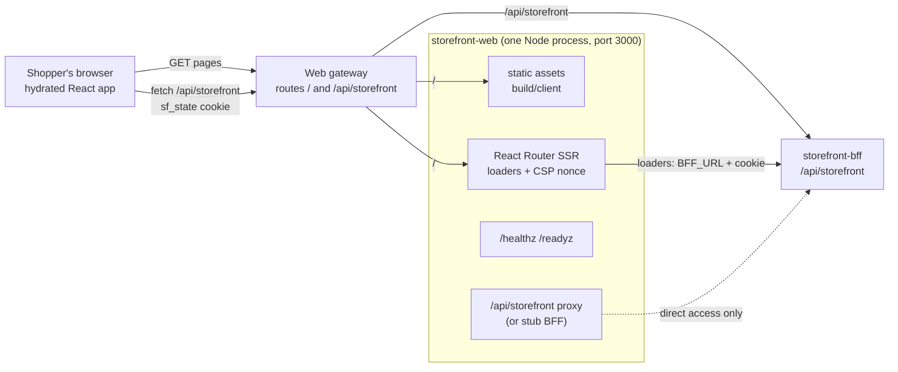

# Architecture

storefront-web is a **single Node process** that serves a React Router 7 application in framework mode with server-side rendering (`ssr: true` in `react-router.config.ts`, ADR 0001). It has no database, no queue and no domain model; every fact comes from the storefront-bff.

## Containers

Source: `server/index.ts` (listener, routing order, probes), `server/proxy.ts`, `server/static.ts`, `app/entry.server.tsx`, `app/lib/api.server.ts`, `app/lib/api.ts`.

| Container | Role | Port | Data |
|---|---|---|---|
| `server/index.ts` (`node server/index.ts`) | the only binary: probes, `/api/storefront` proxy or stub, static files, SSR | `PORT`, default 3000 | none (stateless) |
| Browser bundle (`build/client`) | hydrates the pages, runs client loaders and actions, talks only to `/api/storefront` | n/a | `localStorage`, `sessionStorage`, cookies (opaque ids only) |
| storefront-bff | the only backend; composes the storefront and retail-network services | `BFF_URL` | owned elsewhere |
| Web gateway | exposure: `/` to this Service, `/api/storefront` to the BFF | n/a | outside this repo |

There is no data store. The Helm chart (`charts/storefront-web`) deploys one Deployment, one Service (80 to 3000) and a ConfigMap.

## Request handling order

For every request `server/index.ts` decides, in this order:

1. `GET /healthz` or `/readyz`: `200 ok`, no BFF check.
2. `/api/storefront` or `/api/storefront/*`: the stub handler when `STOREFRONT_STUB=1` (it answers every path under the prefix, with a 404 problem for unknown ones), otherwise `proxyToBff` (pinned to `BFF_URL`, 20 s timeout, 503 problem+json when unreachable, 400 for a request target that carries its own host).
3. A file under `build/client` for GET/HEAD (`serveStatic`: immutable cache for `/assets/*`, Brotli or gzip above 1 KiB).
4. Everything else: the React Router request listener (`createRequestListener`, `mode: "production"`) which renders the matching route.

A failure anywhere in the async handler answers a bare 500.

## Routes and loaders

`app/routes.ts` declares nine routes. The split between server `loader`s and browser `clientLoader`s follows from where the state cookie can be read (below).

| Route | Module | Data loading | BFF calls (`app/lib/queries.ts`) |
|---|---|---|---|
| `/` (index) | `routes/home.tsx` | server `loader`, `Cache-Control: private, max-age=0, must-revalidate` | `GET /categories`, then up to four `GET /products?categoryId=&limit=6` in parallel (the busiest departments); without a category tree one `GET /products?limit=48` grouped by department |
| `/search` | `routes/search.tsx` | server `loader` | `GET /products` with `q`, `categoryId`, `inStock`, `priceMin`, `priceMax`, `sort`, `cursor`, `limit` from the URL |
| `/products/:id` | `routes/product.tsx` | server `loader` (404 from the BFF becomes a 404 page) | `GET /products/{id}`; the buy box then calls `POST /products/{id}/delivery-date-quotes` in the browser |
| `/cart` | `routes/cart.tsx` | `clientLoader` + `clientAction` | cart read, line quantity and removal, destination, `delivery-quotes`, `delivery-selection`, product titles, delivery dates for charges |
| `/account` | `routes/account.tsx` | `clientLoader` + `clientAction` | `GET /me`, `POST /sessions`, `POST /shoppers`, `POST /me/addresses` |
| `/checkout` | `routes/checkout.tsx` | `clientLoader` (redirects to `/account` without a shopper, to `/cart` when the cart is not ready) + `clientAction` (`open`, `confirm`) | `POST /checkout`, `GET /checkout/{id}`, `POST /checkout/{id}/confirmations`, cart and product reads |
| `/confirmation/:sessionId` | `routes/confirmation.tsx` | `clientLoader`; polls by revalidating every 2 s up to 30 times while the session is `PLACING` or `AUTHORIZING` | `GET /checkout/{id}`, then `GET /orders/{id}` and `GET /carts/{id}` once `COMPLETED` |
| `/orders` | `routes/orders.tsx` | `clientLoader` | `GET /orders` |
| `/orders/:id` | `routes/order-detail.tsx` | `clientLoader` + `clientAction` (cancel) | `GET /orders/{id}`, product reads, `POST /orders/{id}/cancellations` |

The root route (`app/root.tsx`) also has a server `loader`: it fetches `GET /categories` (failure tolerated) for the department bar and reads the `sf_dest` cookie, and `shouldRevalidate` returns `false` so it runs once per document. The root `ErrorBoundary` turns a route error response or an `ApiError` into a shopper-facing message.

Source: `app/routes.ts`, `app/routes/*.tsx`, `app/root.tsx`.

## The BFF client

- `app/lib/api.ts` is the **only** place that knows a backend base: `API_BASE = "/api/storefront"`. `callRaw`/`call` send `Accept: application/json, application/problem+json`, `Content-Type: application/json` when there is a body, `Idempotency-Key` on every POST and PATCH (the caller's per-action key, else a fresh UUID), and `credentials: "same-origin"`. A non-2xx answer throws `ApiError` carrying the RFC 9457 problem; `ApiError.slug` is the last segment of the problem type (for example `session-required`).
- `app/lib/queries.ts` has one one-liner per BFF operation (23 operations, listed on [Integration](../ecosystem/integration.md)). Path segments go through `seg()` (URL-encoded) and query strings through `query()` (empty values dropped).
- `app/lib/api.server.ts` is a `.server` module, excluded from the client bundle by React Router. `serverBase()` returns `<BFF_URL>/api/storefront`; `serverOpts(request)` adds the incoming `Cookie` header and the request's abort signal for SSR loader calls.
- `app/lib/action-id.ts` mints one `Idempotency-Key` value per user action: the same click retried reuses it (so the BFF deduplicates), and it is renewed after success.
- `app/components/ProblemAlert.tsx` maps stable problem slugs (`session-required`, `cancel-after-lock`, `payment-declined`, `stale-delivery-selection`) and 503/504 to shopper-facing text; route actions never throw to the boundary (`guarded` in `app/lib/action-result.ts`).

Source: `app/lib/api.ts`, `app/lib/queries.ts`, `app/lib/api.server.ts`, `app/lib/action-id.ts`, `app/components/ProblemAlert.tsx`.

## Cookie and browser state

The BFF sets `sf_state` (cart, shopper and last-checkout ids) as `HttpOnly; SameSite=Lax; Path=/api/storefront` (ADR 0002; the stub does the same, `server/stub.ts`). That has two consequences that shape the whole app:

1. **A page request never carries `sf_state`**, because its path is not under `/api/storefront`. The server cannot render shopper-state pages, so cart, account, checkout, confirmation and orders use `clientLoader` with a `HydrateFallback` skeleton (ADR 0001). Catalogue pages use server loaders.
2. **Page code cannot read the ids**, so it remembers the opaque ids the BFF returned:

| Key | Storage | Written by | Meaning |
|---|---|---|---|
| `sf.cartId` | `localStorage` | `app/lib/cart-session.ts` | the open cart; re-validated with `GET /carts/{id}` on every use, forgotten on 404 or when not `OPEN` |
| `sf.shopperId` | `localStorage` | `app/lib/shopper.ts` | a marker that a sign-in or registration succeeded, so `GET /carts` and `/me` are never called for an anonymous visitor (they answer 422); `/me` stays the authority |
| `sf.checkoutId` | `sessionStorage` | `routes/checkout.tsx` | the open checkout session, resumed if still `OPEN` or `DECLINED` |
| `sf_dest` | first-party cookie, `Path=/`, 30 days | `app/lib/destination.ts` | the typed ZIP and its 3-character prefix only, readable by SSR so the header chip renders without layout shift |

The delivery destination is always `postalPrefixOf(zip)`: the shopper types `78701`, the BFF receives `787`.

## Strict Content-Security-Policy

`app/entry.server.tsx` generates a fresh 16-byte nonce per request (`newNonce`) and sets, on every HTML response, the policy built by `contentSecurityPolicy(nonce)` in `app/csp.ts`, plus four fixed headers:

| Directive | Value |
|---|---|
| `default-src` | `'none'` |
| `script-src` | `'self' 'nonce-<nonce>'` (the nonce goes on React Router's inline hydration data) |
| `style-src` | `'self'` (one fingerprinted stylesheet, `app/app.css`, no inline styles) |
| `img-src` / `font-src` / `connect-src` / `manifest-src` | `'self' data:` / `'self'` / `'self'` / `'self'` |
| `base-uri` / `object-src` / `frame-ancestors` | `'none'` |
| `form-action` | `'self'` |

Headers: `X-Content-Type-Options: nosniff`, `Referrer-Policy: strict-origin-when-cross-origin`, `Permissions-Policy: camera=(), microphone=(), geolocation=(), payment=()`, `Cross-Origin-Opener-Policy: same-origin`. `connect-src 'self'` means the bundle can only call this origin, which is how the `/api/storefront`-only rule holds at run time as well as build time (ADR 0003). Product media URLs that point at the storefront host are rewritten to same-origin paths by `mediaSrc` (`app/lib/departments.ts`).

## Server-side rendering

`handleRequest` in `app/entry.server.tsx` uses `renderToPipeableStream`: crawlers (`isbot`) wait for `onAllReady`, shoppers get the shell at `onShellReady` and the rest streams in. The document is compressed (Brotli quality 5, else gzip, `Vary: Accept-Encoding`) because it is on the LCP path (ADR 0005). `streamTimeout` is 5 s and the render aborts at 6 s. The client entry (`app/entry.client.tsx`) hydrates with `hydrateRoot` in `StrictMode`. Promise windows are formatted with an explicit IANA zone (the window's `timeZone`, else UTC), never the server's or browser's zone, so server and client render the same text (ADR 0006, `app/lib/dates.ts`).

## Simulated payment

`app/components/PaymentFields.tsx` renders a labelled sandbox in place of a provider iframe: no card number, expiry or CVC input exists. The shopper picks a scenario (`approve`, `decline`, `timeout`) and the only payment value posted is `paymentMethodToken = tok_<scenario>` (`app/lib/payment.ts`; `isScenario` rejects anything else). Outcomes: `COMPLETED` redirects to the confirmation, `DECLINED` stays on checkout, `PLACING`/`AUTHORIZING` redirect to the confirmation which polls, `REQUOTE_REQUIRED`/`EXPIRED`/`FAILED` explain that nothing was charged (ADR 0004, `app/lib/checkout.ts`).

## The stub BFF

When `STOREFRONT_STUB=1`, `server/stub-handler.ts` answers `/api/storefront` from in-memory synthetic data (`server/fixtures.ts`, `stub.ts`, `stub-commerce.ts`, `stub-delivery.ts`, `stub-state.ts`) and the server points `BFF_URL` at its own loopback so SSR loaders use it too. It reproduces the real contract's strictness (unknown field is 400, only prefixes 786 and 787 served, 422 `session-required`). It is for CI, Lighthouse and demos; the chart refuses to deploy it (ADR 0005).

## Build and image

`npm run build` (`react-router build`, Vite) writes `build/client` and `build/server`. The multi-stage `Dockerfile` builds on `node:22-slim`, runs `npm run build && npm run check:bundle && npm prune --omit=dev`, and the runtime stage copies `package.json`, `node_modules`, `build/` and `server/` and runs as user `node` with `CMD ["node", "server/index.ts"]` (TypeScript executed through Node's type stripping, hence Node `>=22.18`). Source files outside `build/` and `server/` are not shipped.

## Known inconsistencies

- ADR 0001 and the README stack line say Vite 7; `package.json` pins `vite` `8.3.5`. ADR bodies are immutable, so this page follows the code.
- ADR 0001 says the server answers `/healthz`; the code answers `/healthz` and `/readyz` (`server/index.ts`).
- The chart renders `COOKIE_SECURE` but no code reads it (see [Configuration](../operations/configuration.md)).
